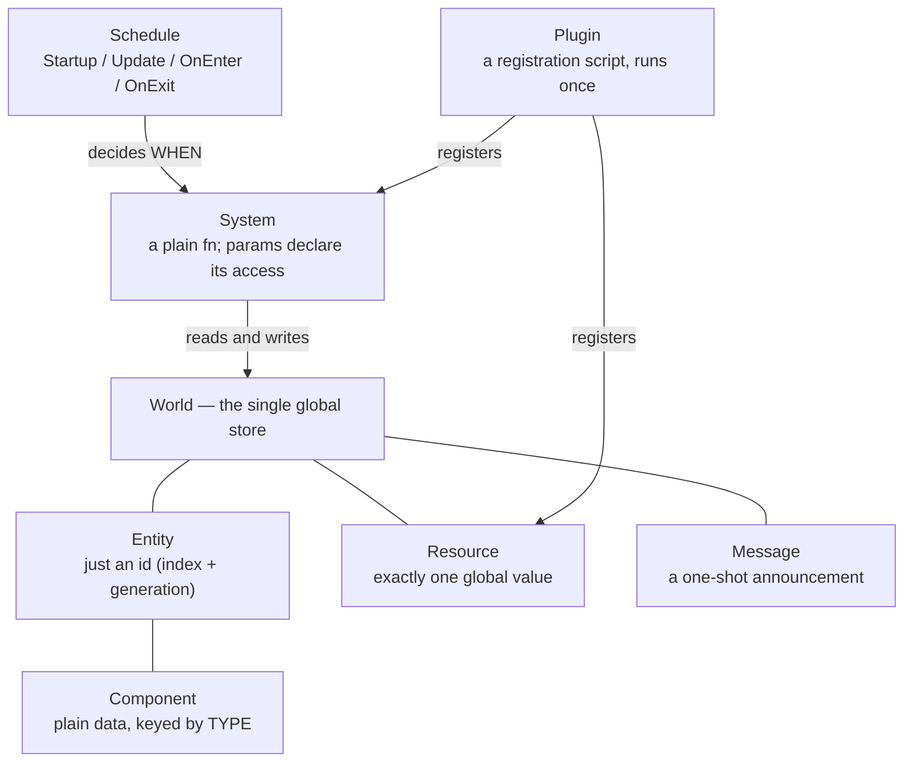

# Bevy ECS — the architecture Phoenix is actually built on

Replaces [[OOP-Foundations]] for the Bevy era. That note described an object graph —
`AActor` subclasses owning their own data and methods. **Bevy has no object graph**, and almost
every confusion while building M1 traced back to still looking for one.

Everything below is illustrated with code already in `~/Workspace/phoenix`.

## The whole model in one picture



## The six concepts, in Phoenix's own code

| concept | what it is | in Phoenix |
|---|---|---|
| **Entity** | an id. 8 bytes, `Copy`. Holds no data and grants no access. | the player, each enemy, each damage number |
| **Component** | plain data attached to an entity, stored **keyed by type** | `Player`, `Enemy`, `Health`, `Speed`, `MoveTarget`, `Knockback`, `HitFlash` |
| **Resource** | exactly one global value of its type | `DeathMode`, `EnemyMaterials`, `HitStop`, `Time`, `ButtonInput<KeyCode>` |
| **Message** | a one-shot announcement; every reader keeps its own cursor | `PlayerDied`, `Hit` |
| **System** | an ordinary `fn`; its **parameters declare what it touches** | `move_to_target`, `enemy_chase`, `player_attack`, `death` |
| **Schedule** | when a system runs | `Startup`, `Update`, `OnEnter(Playing)`, `OnExit(Playing)` |

## There is no object graph

`Player` is the entire definition of a player:

```rust
#[derive(Component)]
pub struct Player;
```

Zero fields. It is a **label**. The player entity is an id with independent components sitting
beside each other — `Transform`, `Speed`, `Health`, `Damage`, `AttackTimer`, `Mesh3d`, `Player` —
and none is inside another.

Consequences that keep coming up:

- **Behaviour attaches to a component set, not to a type.** `move_to_target` queries
  `(Entity, &mut Transform, &MoveTarget, &Speed)` and therefore moves the player *and* the enemies
  with no knowledge of either. Five enemies cost zero new behaviour code.
- **Two identical structs in different modules are different types.** `movement::Speed` and
  `player::Speed` would never match the same query — the near-miss that would have silently
  stopped the player moving.
- **State is the presence of a component.** No `is_moving` flag: having `MoveTarget` *is* walking,
  having `Knockback` *is* being knocked back. `insert` enters the state, `remove` leaves it, and a
  system does one frame of work for whoever is currently in it.

## A plugin owns nothing

`EnemyPlugin::build()` runs **once**, at `add_plugins` time, calls `add_systems` / `init_resource`,
and is then finished permanently. It does not wrap, own or mediate the systems it registered.
Paste its three lines into `main.rs` and the game is identical; the plugin exists so registrations
sit beside the code they register.

Evidence there is no plugin scoping — the same call appears under four different plugins, all
acting on the one World:

```
combat.rs:172   commands.entity(entity).despawn();        CombatPlugin
enemy.rs:164    commands.entity(entity).try_remove::<…>() EnemyPlugin
player.rs:102   commands.entity(entity).remove::<…>();    PlayerPlugin
ui.rs:134       commands.entity(entity).despawn();        UIPlugin
```

## Systems get their arguments by type

`SystemParam` is type-directed injection — Bevy reads the parameter types and supplies them.
`Commands`, `Res<T>`, `ResMut<T>`, `Query<D, F>`, `Single<D, F>`, `MessageReader<T>`,
`MessageWriter<T>` are all `SystemParam`.

Two consequences:

1. **Parallelism is free and automatic.** `&T` versus `&mut T` in the signature is the whole
   declaration; the scheduler runs non-conflicting systems concurrently with no locks.
2. **Conflicts are refused, not risked.** Two params touching the same component where one is
   `&mut` is error **B0001** at startup. Fix by proving the sets disjoint (`Without<Player>` on the
   camera query) or, when the sets are genuinely the same, by a two-pass snapshot
   (`enemy_separation`).

## Commands are a queue, not an action

`commands.entity(id)` performs **no lookup and no validation** — it returns an `EntityCommands`
that remembers the id and a handle to the queue. The operation is applied at the next sync point,
where the entity physically moves between archetypes.

That deferral is why structural changes cannot be immediate: moving an entity between archetypes
mid-iteration would invalidate the query being looped over.

And it is why **a query guard cannot protect a command**: the despawn you are racing is *also*
queued, so "does it exist now" does not answer "will it exist when my command lands". The only
answer is to tell the queued command what to do on arrival — `try_insert`, `try_remove`,
`try_despawn`.

> **Rule:** `insert` / `remove` / `despawn` when you own the entity's lifetime; the `try_` variant
> when you learned the entity from a message, a stored `Entity`, or another system's output.

## Nothing in Phoenix draws anything

No system here renders. They change `Transform.translation`. Bevy's renderer reads each entity's
`GlobalTransform` every frame and draws the mesh wherever that says.

**To move something, change its data — the picture follows.** `Transform` is the editable local
description (`translation: Vec3`, `rotation: Quat`, `scale: Vec3`); `GlobalTransform` is the
composed world-space matrix (`Affine3A`) Bevy derives from the hierarchy.

## Where the clock comes from

`Res<Time>` is **virtual** time — scalable and pausable, and every `delta_secs()` in the project
reads it. `Time<Real>` is wall-clock. Anything measuring how long an effect *on time* should last
must read the clock that effect does not touch — the hitstop timer is the lived case.

## Related

- [[Bevy-Research-2026-09-25]] — why Bevy was chosen; ecosystem and costs
- [[Build-Log]] — the checkpoint-by-checkpoint record these lessons came from
- [[OOP-Foundations]] — superseded, Unreal-era object model
- [[Decisions]] ADR-008 — the switch to Rust + Bevy
