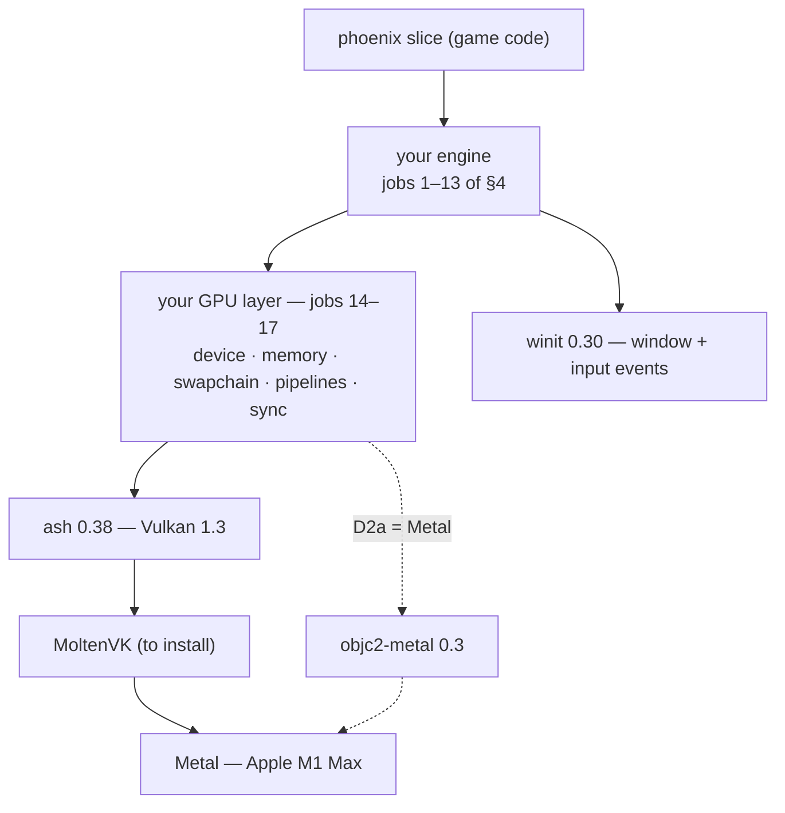
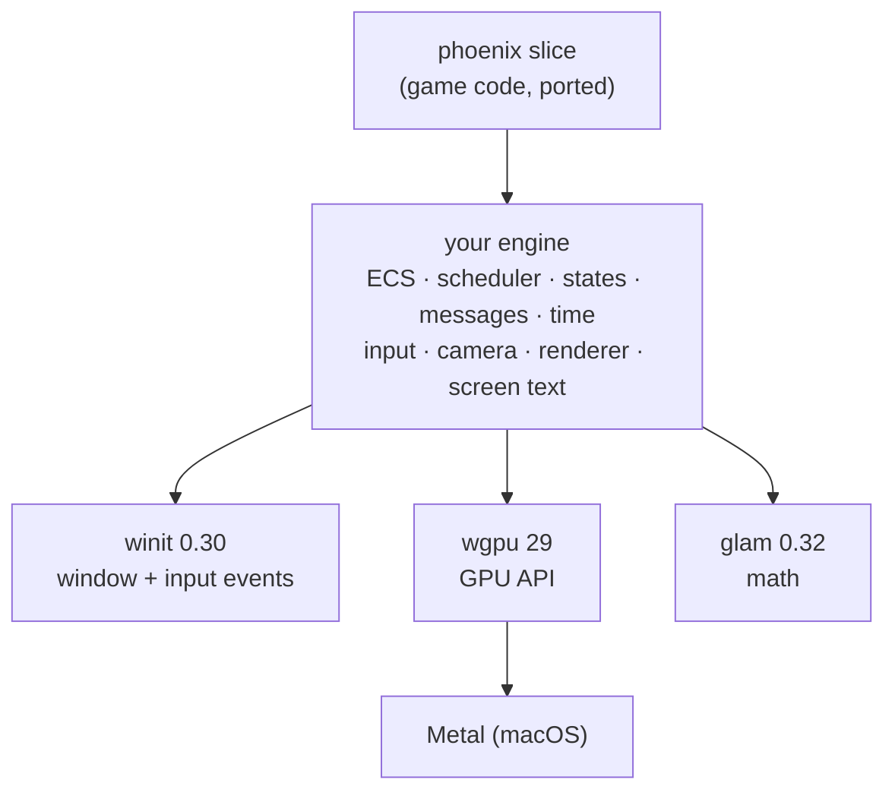

# Engine — Plan

> [!info] **What this is.** The plan paper for building my own game engine in Rust. Started 2026-11-11
> at the user's request: *"I am planning to build own game engine with rust. I did once at the
> university, so we can proceed the plan paper."*
> **Planning only — no engine code is written under this paper until the user says "go build".**
> **Two decisions are open ([[#5. Open decisions]]).** Everything after §5 waits on them.

## Revision history

| rev | date | what changed |
|---|---|---|
| r0 | 2026-11-11 | Skeleton: history, what phoenix asks of an engine today (read from the code), open decisions D1–D2, parked decisions, NOT verified. |
| r1 | 2026-11-11 | User answered *"B, Like vulkan"* — recorded under D2, awaiting confirmation; new D2a (Vulkan or Metal) with what this Mac has; §3.1 the university engine, found and read (CS-112, WebGL); its NOT-verified entry struck. |

## 1. Where this paper sits in the four steps

- **Step 1, the research paper, was waived by the user** for the engine as a whole — reason given:
  they built an engine at university. So this paper carries its own evidence. Every fact is tagged
  with how it was established:
  - **code** — read in `~/Workspace/phoenix`, cited as `file:line` (working tree, 2026-11-11)
  - **lock** — read in `~/Workspace/phoenix/Cargo.lock`
  - **vault** — a note in this vault, quoted
  - **user** — the user said it
  - **probe** — a read-only check run on this Mac, with the command named
  - **general** — general knowledge, **not checked against a source** in this paper
- The crate APIs the engine will call are still read from their source before this paper names a
  single call (checklist item 3 in §7). Waiving the research step does not waive that.

## 2. History — the engine question was decided once already

**vault** — [[Decisions]] ADR-005 (2026-09-14):

> Writing an engine is a different project that teaches *how engines work*, and is deferred to a
> **separate project**, started after Phoenix has taught the game-building side.

and, among its alternatives, *"a thin C framework such as SDL or raylib (rejected **for Phoenix**,
noted as a good starting point for the future engine project)"*.

**vault** — [[Decisions]] ADR-008 (2026-09-25), alternatives considered: *"Rust without Bevy, engine
from scratch (that remains the separate project of ADR-005)."*

So the record says: a separate project, after phoenix has taught the game side. Decision D1 asks
whether that still holds.

## 3. Phoenix today

- **code** — `Cargo.toml`: edition 2024, `bevy = { version = "0.19.1", features = ["debug"] }`.
- **code** — 948 lines in 10 files under `src/`; 8 plugins registered from `main.rs`. Last commit
  `54b07c9 add: knockback on hit`; uncommitted changes in `Cargo.toml`, `combat.rs`, `enemy.rs`,
  `main.rs`, `ui.rs`; `loot.rs` is untracked and not in `main.rs`'s `mod` list.
- **lock** — Bevy 0.19.1 is itself built on: `winit` 0.30.13, `wgpu` 29.0.4, `naga` 29.0.4,
  `glam` 0.32.1.
- **general** — roles of those four: `winit` opens windows and delivers input events; `wgpu` is a GPU
  API over Metal, Vulkan and DirectX 12; `naga` translates shaders; `glam` is vector and matrix math.

### 3.1 What you built before — CS-112, WebGL (2018)

**user** — *"I built engine on webgl, it should be somewhere in the sjw2023's repository."*
It is `github.com/sjw2023/CS-112` ("UCI Computer Graphics", created 2018-11-28, 11 commits); a local
copy is at `~/Workspace/UCI/112/Project/CS-112`.

**code** — what it implements (counts over the user's own `.js`/`.html` files, excluding the bundled
`gl-matrix`, `webgl-utils` and trackball files; about 9,800 lines):

| engine part | evidence |
|---|---|
| Hand-written GLSL shaders, compiled and linked by its own code | `createShader` 14, `createProgram` 13 (`final_project/Final.js:154`), `gl_FragColor` 16 |
| Indexed mesh drawing | `gl.drawElements` 8 |
| Lighting: diffuse + specular with normal matrices, several lights (moon, pole light, car headlights) | `diffuse` 68, `specular` 84, `normalMatrix` 33; `Final.js` `draw()` passes `pointLightPosition`, `leftLightPosition`, `rightLightPosition`, `carLightDirection` |
| Perspective camera, trackball view | `mat4.perspective` 6, `mat4.lookAt` 2, `rotator.getViewMatrix()` in `Final.js` `draw()` |
| Textures and a cube-map skybox | `createTexture` 3, `TEXTURE_CUBE_MAP` 11 (`PA3/PA3/skybox.js`) |
| Input and a frame loop | `keydown` 6, `mousedown` 1, `requestAnimationFrame` 2 |
| **Not in it** | off-screen render targets (`createFramebuffer` 0), shadows (`shadow` 0); vector math came from `gl-matrix` |

Against §4, this covers most of job 12 (3D rendering) and part of jobs 8–10 (input, window, camera).
Jobs 1–7 (app, scheduling, ECS, spawning, messages, states, two clocks) and job 13 (screen text) are new.

## 4. What phoenix asks of an engine — the requirement list

**code** — every Bevy item phoenix uses, grouped by the engine job it stands for. "Uses" is the
number of occurrences in `src/*.rs`; "first use" is its first occurrence, reading the files in
alphabetical order (every cited line was re-checked against the code on 2026-11-11). If the engine is to run
phoenix's current slice (D1 options B or C), **these 13 jobs are its minimum**.

| # | engine job | what phoenix uses | uses | first use |
|---|---|---|---|---|
| 1 | App and plugins | `App::new`, `DefaultPlugins`, `impl Plugin`, `add_systems` | 1 · 1 · 8 · 17 | `main.rs:12`, `main.rs:13`, `combat.rs:42`, `camera.rs:10` |
| 2 | Scheduling | `Startup`, `Update`, `run_if` + `in_state`, `OnEnter` / `OnExit` | 3 · 9 · 5+5 · 3/2 | `camera.rs:10`, `camera.rs:11`, `enemy.rs:132` + `combat.rs:48`, `enemy.rs:119` / `combat.rs:51` |
| 3 | ECS data and queries | `Component`, `Resource`, `Entity`, `Query`, `Single`, `With` / `Without`, `Res` / `ResMut`, `Commands` | 13 · 4 · 17 · 15 · 14 · 20/1 · 21/12 · 22 | `combat.rs:15`, `combat.rs:12`, `combat.rs:23`, `combat.rs:59`, `camera.rs:16`, `camera.rs:16` / `camera.rs:17`, `combat.rs:97` / `combat.rs:84`, `camera.rs:23` |
| 4 | Spawn, insert, despawn | `.spawn(`, `.insert(`, `despawn` | 9 · 2 · 9 | `camera.rs:24`, `enemy.rs:240`, `enemy.rs:88` |
| 5 | Messages between systems | `Message` derive, `add_message`, `MessageWriter`, `MessageReader` | 3 · 3 · 3 · 7 | `combat.rs:21`, `main.rs:14`, `combat.rs:57`, `combat.rs:83` |
| 6 | Game states | `States`, `init_state`, `NextState` | 1 · 1 · 2 | `game_state.rs:22`, `game_state.rs:7`, `game_state.rs:32` |
| 7 | Time — two clocks | `Res<Time>`, `Time<Virtual>` + `set_relative_speed`, `Time<Real>`, `Timer` (`tick`, `just_finished`) | 9 · 2+2 · 1 · 7 | `combat.rs:111`, `combat.rs:85`, `combat.rs:97`, `combat.rs:92` |
| 8 | Input | `ButtonInput<KeyCode>`, `ButtonInput<MouseButton>`, `just_pressed` | 3 · 1 · 5 | `game_state.rs:30`, `player.rs:108` |
| 9 | Window and cursor | `Window`, `cursor_position` | 1 · 1 | `player.rs:110`, `player.rs:120` |
| 10 | Camera and picking | `Camera3d`, `looking_at`, `viewport_to_world`, `plane_intersection_point` + `InfinitePlane3d` | 2 · 1 · 1 · 1 | `camera.rs:17`, `camera.rs:26`, `player.rs:124`, `player.rs:128` |
| 11 | Transforms | `Transform`, `GlobalTransform` | many · 2 | `camera.rs:26`, `player.rs:109` |
| 12 | 3D rendering | `Mesh3d`, `MeshMaterial3d`, `StandardMaterial`, `Handle`, `Assets<Mesh>`, `Cuboid`, `Plane3d`, `PointLight`, `Color` | 5 · 7 · 9 · 4 · 4 · 4 · 1 · 1 · 11 | `enemy.rs:69`, `enemy.rs:70`, `enemy.rs:36`, `enemy.rs:35`, `enemy.rs:42`, `enemy.rs:43`, `world.rs:17`, `world.rs:21`, `enemy.rs:46` |
| 13 | Screen text | `Text`, `TextFont`, `TextColor`, `Node` (absolute position) | 3 · 3 · 3 · 7 | `ui.rs:53`, `ui.rs:54`, `ui.rs:58`, `ui.rs:59` |

**code** — not used today, so not on the first target: audio (`Audio` 0), file assets (`AssetServer`
0, `load(` 0), sprites (`Sprite` 0), entity hierarchy (`ChildOf` 0, `with_children` 0), `Gizmos` 0.

### 4.1 The three jobs that are more than plumbing

**Picking (job 10).** The click becomes a ray from the camera and meets the ground plane.
The engine's camera has to expose the inverse of its view and projection to do this.

```rust
// player.rs:120-133
let Some(cursor) = window.cursor_position() else {
    return; // Pointer is outside the window
};

let Ok(ray) = camera.viewport_to_world(camera_transform, cursor) else {
    return; // camera coudn't build a ray
};

let Some(point) = ray.plane_intersection_point(Vec3::ZERO, InfinitePlane3d::new(Vec3::Y))
else {
    return; // ray never meets the ground
};

commands.entity(*player).insert(MoveTarget(point));
```

**Two clocks (job 7).** Hit-stop slows game time and ends on a timer that runs on real time, so
the slowdown never delays its own end. The engine's time module needs both clocks, and a speed
factor on the virtual one.

```rust
// combat.rs:92-93 (hitstop_start) and combat.rs:105-107 (hitstop_end)
stop.0 = Some(Timer::from_seconds(HITSTOP_SECONDS, TimerMode::Once));
virtual_time.set_relative_speed(HITSTOP_SPEED);
// ...
if timer.tick(real_time.delta()).just_finished() {
    virtual_time.set_relative_speed(1.0);
    stop.0 = None;
}
```

**Screen text (job 13).** Damage numbers are text spawned at a screen position each hit.
**general** — this needs a font rasterizer, a glyph atlas texture and screen-space layout, and is
usually the largest single job on a list like this one.

```rust
// ui.rs:52-62
commands.spawn((
    Text::new(format!("{}", hit.amount as i32)),
    TextFont {
        font_size: FontSize::Px(28.0),
        ..Default::default()
    },
    TextColor(Color::srgb(1.0, 0.9, 0.35)),
    Node {
        position_type: PositionType::Absolute,
        ..default()
    },
```

## 5. Open decisions

### D1 — How does the engine relate to phoenix?

| option | what it means | what it costs |
|---|---|---|
| **A.** Separate project; phoenix stays on Bevy (ADR-005 and ADR-008 as written) | Engine gets its own repo; phoenix keeps moving | The engine has no finish line unless one is chosen |
| **B.** Phoenix moves onto the engine (supersedes ADR-005 and ADR-008) | Phoenix gameplay work stops until the engine does all 13 jobs in §4 | Every pillar waits on the engine — the cost ADR-005 rejected |
| **C.** Separate engine whose **first target is a port of phoenix's current slice**; phoenix itself stays on Bevy | The engine is "done" for milestone 1 when the same slice runs on it | The slice exists twice |

**Recommendation: C.** It keeps ADR-005's reason (phoenix is not blocked), and gives the engine a
finish line that can be tested side by side with the Bevy build: the same click-to-move, the same
hit-stop, the same damage numbers.

### D2 — How low does "own engine" go?

| option | you write | crates do | platform |
|---|---|---|---|
| **A.** On `winit` + `wgpu` + `glam` — the layer Bevy 0.19.1 itself is built on (**lock**) | All 13 jobs in §4: ECS, scheduler, states, messages, time, input mapping, camera, renderer, text | Window and input events, the GPU API, shader translation, math | macOS through Metal (**general**) |
| **B.** Raw Metal | Also the GPU layer | Window only | macOS only, permanently |
| **C.** SDL bindings + OpenGL | Also the GPU layer | Window, input | OpenGL is deprecated on macOS (**general**) |

**Recommendation (r0): A.** Everything on the §4 list is yours to write. What is left to crates is the
part that differs per operating system and teaches least about how an engine works. It is the Rust
counterpart of what ADR-005 already named as the starting point (a thin framework such as SDL).

> [!warning] **Answer received, not yet confirmed.** **user**, 2026-11-11: *"B, Like vulkan"*.
> Read as: **D2 = B — you write the GPU layer yourself, on an explicit graphics API of the Vulkan
> kind**; `winit` still opens the window. The reply named one letter for two questions, so D1 is
> asked again rather than assumed. If "B" was meant for D1, this paper changes: phoenix gameplay
> work would stop until the engine does all 13 jobs.

What option B adds to §4 (**general** — the usual parts of an explicit GPU API, to be read from
the chosen crate in checklist item 3): **14** GPU device, queues and memory for buffers and
textures · **15** presenting frames to the window (surface and swapchain) · **16** pipelines and
compiled shaders · **17** CPU–GPU synchronisation.

#### D2a — which explicit API

| | Vulkan | Metal |
|---|---|---|
| Rust crate | `ash` 0.38.0, built on Vulkan headers 1.3.281 (**lock**) | `objc2-metal` 0.3.2 (**lock**) |
| Same crate `wgpu` uses for that backend | yes — `wgpu-hal` 29.0.4 depends on `ash` (**lock**) | yes — `wgpu-hal` 29.0.4 depends on `objc2-metal` 0.3.2 (**lock**) |
| On this Mac | Not native: runs through MoltenVK, which translates Vulkan to Metal (**general**). **Not installed** (**probe** 2026-11-11: no `vulkaninfo`; no `~/VulkanSDK`; no `libvulkan` or `libMoltenVK` in `/usr/local/lib` or `/opt/homebrew/lib`; no Homebrew formula) | Native: Apple M1 Max, "Metal Support: Metal 4", macOS 27.0.1 (**probe** — `system_profiler SPDisplaysDataType`, `sw_vers`) |
| Runs elsewhere | Windows, Linux, Android (**general**) | Apple platforms only (**general**) |
| Shaders written in | GLSL or HLSL compiled to SPIR-V (**general**) | Metal Shading Language (**general**) — your CS-112 shaders are GLSL (§3.1) |

**Recommendation: Vulkan** — it is the API you named, your GLSL experience carries over, and what
you learn works on every desktop platform. The cost: the Vulkan SDK (with MoltenVK) has to be
installed on this Mac first, and MoltenVK supports only part of Vulkan (**general** — to be
checked in checklist item 3). Metal is the choice if you want no translation layer and accept
Apple-only.





## 6. Parked — decided later, one at a time

- ECS storage: archetype tables or sparse sets.
- Scheduler: single-threaded first, or parallel systems from the start.
- Renderer: forward shading; simple diffuse lighting or physically based (**general** — Bevy's
  `StandardMaterial` is physically based).
- Screen text: a font-rasterizing crate, or a rasterizer of your own.
- Assets: none needed for the first target — meshes are built in code (**code** — `Cuboid`,
  `Plane3d`; `load(` 0).
- Audio and networking (ADR-007 co-op): outside the first target.
- **Names** — the engine's name, repo and vault location. New names need the user's approval.

## 7. Checklist

- [ ] 1. D1 decided → recorded as a new ADR in [[Decisions]]
- [ ] 2. D2 decided → same ADR
- [ ] 2a. D2a decided (Vulkan or Metal); if Vulkan, the Vulkan SDK install is approved by the user
- [ ] 3. Read the chosen crates from source for every call this paper will name (signature, and one
      real call each: open a window, clear the screen to a colour)
- [ ] 4. Per-job design for the 13 jobs in §4, with the code to be written
- [ ] 5. Comment step: the user reads; an independent reviewer runs on the paper
- ⛔ No engine code until the user says "go build".

## 8. NOT verified

- ~~**The university engine.** On disk, only two related projects were found, and neither is an
  engine: the CS 112 WebGL project and the CS 113 "PvE" Unity game.~~ **Resolved r1:** the user
  named it — the WebGL engine is CS-112. Read and recorded in §3.1.
- **Target platform.** ADR-006 set "macOS only" for the Unreal toolchain. It has not been decided
  for the engine.
- **Crate roles and "wgpu runs on Metal"** — general knowledge; settled by checklist item 3.
- **Whether phoenix's working tree builds today** — not run; this paper is reading only.
